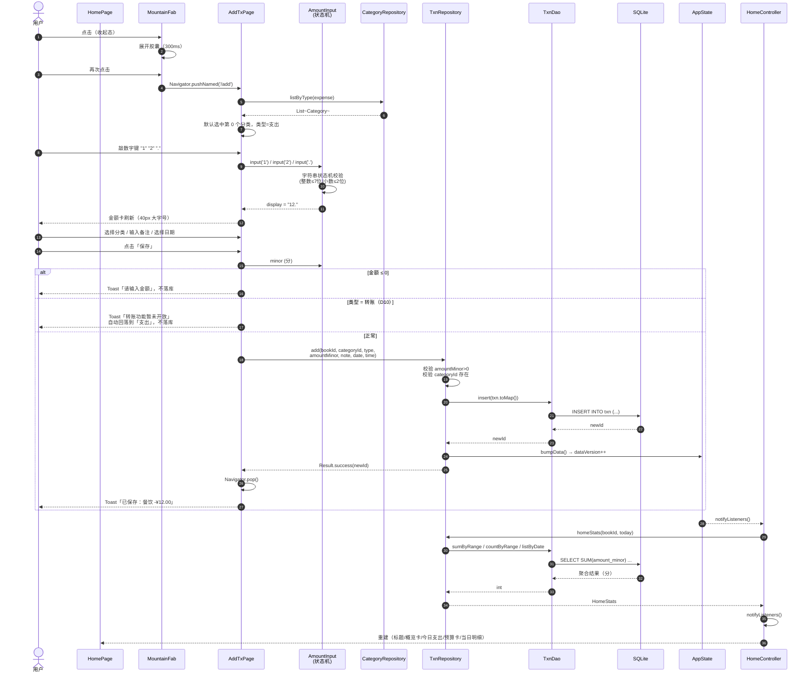
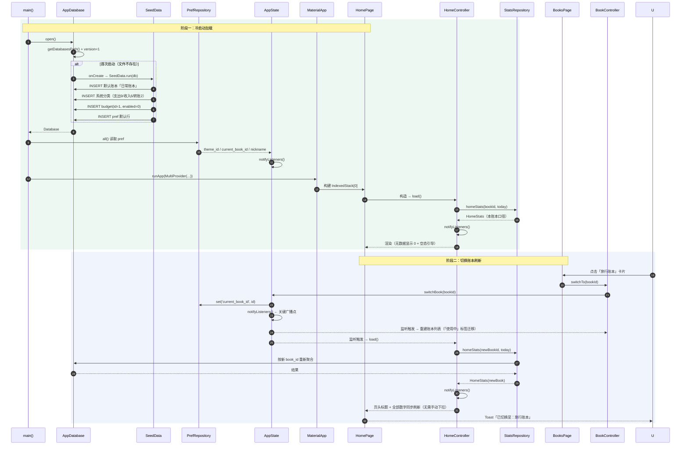
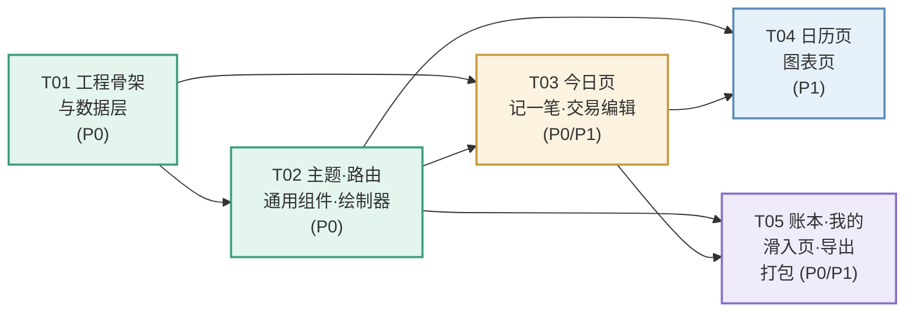

# 轻记 · 系统架构设计与任务分解

> 作者：高见远（架构师） ｜ 面向：寇豆码（工程师）
> 事实来源优先级：**交互原型（视觉/交互）> PRD（需求口径）> 本文档（实现方案）**
> 运行环境：Flutter **3.32.5** / Dart **3.8.1** / 仅 Android / pub 源可达（腾讯镜像 0.33s）
> 交付范围：**P0 + P1 全量（R01–R22）**，P2 不做；交付物 = 完整源码工程 + 可安装 APK

---

## 0. 决策总表（已拍板，工程师直接执行）

| # | 决策项 | 结论 |
|---|---|---|
| D1 | 交付范围 | R01–R22 全量；R23–R28（P2）不做 |
| D2 | 图标方案 | Material Icons `IconData(codePoint, fontFamily:'MaterialIcons')`。DB 存 `icon_codepoint INTEGER` + `icon_font_family TEXT` + 语义 `icon_key TEXT`。**不引入 flutter_svg** |
| D3 | 首次启动 | 真空账本 +「记第一笔」引导；示例数据入口 ① 首页空态引导卡 ② 分类与账本页底部「演示数据」区（含「载入示例数据」+「清空全部数据」），日期相对今天生成 |
| D4 | 打包 | `minSdk 23 / targetSdk 35 / compileSdk 35`；release 复用 debug keystore 自签，`flutter build apk --release` 直出 |
| D5 | 统计口径归属 | **今日页 / 图表页 / 日历页 / 账本页统计卡 = 当前账本**；**我的页用户卡 = 全局（跨全部账本）**。两处 UI 必须带「本账本」/「全部」标签 |
| D6 | 坚持天数 | 首次记账日 → 今天的自然日跨度，**含首日**（`diff.inDays + 1`），全局口径；无记录显示 0 |
| D7 | 连续打卡 | 从今天（今天无记录则从昨天）向前回溯连续有交易的自然日数；今天和昨天都无记录则为 0。账本页按本账本，我的页按全局 |
| D8 | 预算 | **全局单份**（`budget` 表单行 `id=1`），不分账本；已用 = **全部账本**本月支出合计 |
| D9 | 较上月 | 改为**同期对比**：本月 1 号~今天 vs 上月 1 号~同一天（日取 `min(今天日, 上月天数)`）。文案固定「较上月同期」 |
| D10 | 转账 | UI 保留「转账」分段；**选中即 toast「转账功能暂未开放」并自动回落到「支出」**，绝不落库。DB 保留 `type=3` 与转账分类种子供 P2 |
| D11 | 昵称 | 存 `pref` 表，默认「轻记用户」，点击我的页用户卡可编辑 |
| D12 | 币种/周期 | 单币种 CNY；周期固定**周/月/年**三档，无自定义区间 |
| D13 | 图表 | **CustomPainter 自绘**（确认 PRD 建议）。不引入 fl_chart / syncfusion |
| D14 | 状态管理 | **provider + ChangeNotifier**（轻量、零风险、学习成本低） |
| D15 | 路由 | **Flutter 内置 Navigator 1.0 + 自定义右滑 `SlideRoute`**，不引入 go_router（仅 5 个滑入/全屏页，够用且零依赖） |
| D16 | 依赖注入 | 手写极简 ServiceLocator（`AppLocator` 单例），不引入 get_it |
| D17 | 偏好存储 | 用 SQLite `pref` 表（KV），不引入 shared_preferences |

---

## 1. 实现方案与技术选型

### 1.1 核心技术难点

| 难点 | 说明 | 方案 |
|---|---|---|
| **口径打架** | 原型 326/374 笔、128/21 天互相矛盾；图表页 5 类数据全硬编码 | 建立**单一聚合层 `StatsRepository`**，所有派生指标只在此处定义一次，UI 层禁止自行计算（详见 §5.3） |
| **6 套主题 × 18 Token** | 组件写死色值后无法切换 | `ThemeExtension<AppColors>` + 全局注入；**Code Review 红线：组件内禁止出现 `Color(0xFF…)` 字面量**（分类色板除外，见 §7.4） |
| **日历热度** | 底色 = 主题主色 RGB × 动态 alpha；alpha 随「当日支出 / 当月最大单日支出」变化，且要跟随主题实时重算 | `AppColors.heatBase/heatSpan` 作为 Token 派生 getter；热度在 Controller 层算好注入 Widget，Painter 不参与业务 |
| **自定义键盘状态机** | 整数 7 位 / 小数 2 位 / `00` 双位 / 退格不丢 `.00` | 沿用原型的**字符串状态机**（见 §7.1），保证行为逐位一致 |
| **金额精度** | 浮点 `26.50*100` 会产生 `2650.0000000000005` | 全程 `int` 存分；**元→分用字符串切分解析**，禁用 `double` 中转 |
| **跨页刷新** | 记一笔后首页/日历/图表/账本统计要同步刷新 | `AppState.dataVersion` 版本号总线：写操作后 `bumpData()` → 所有监听 `AppState` 的 Controller 重算 |

### 1.2 技术选型与理由

| 领域 | 选型 | 理由 |
|---|---|---|
| 状态管理 | **provider ^6.1.2**（ChangeNotifier） | 单用户本地 App，页面 <15 个，Provider 足够；无代码生成、无 Riverpod 的 ProviderScope 心智负担；体积最小 |
| 路由 | **Navigator 1.0 + 自定义 SlideRoute** | 只有 5 个非 Tab 页面，无需深层链接/嵌套路由；零依赖，滑入动画 320ms 完全可控 |
| 依赖注入 | **手写 `AppLocator`** | 8 个全局单例，30 行代码搞定，省一个包 |
| 数据库 | **sqflite + raw SQL** | 需要 `SUM/GROUP BY/BETWEEN` 聚合，ORM（如 drift）需要代码生成（build_runner），增加构建复杂度与耗时；本项目 SQL 简单，raw SQL 更透明 |
| 图表 | **CustomPainter 自绘** | 原型图表仅 3 种形态（环/柱/仪表弧），`drawArc` + `RRect` 各 60~120 行；比图表库可控性高、体积小、无依赖风险 |
| 图标 | **Material Icons 字体 + codePoint** | 字体随 Flutter SDK 分发，零依赖零体积；`Icons.xxx.codePoint` 编译期取真值，不存在手写 codePoint 写错的风险 |
| 格式化 | **intl ^0.20.2** | `NumberFormat('#,##0.00')` 千分位；`DateFormat` 处理日期选择器本地化 |
| Toast | **自写 Overlay** | 40 行，避免引入 fluttertoast |
| 本地化 | **flutter_localizations（SDK 内置）** | `showDatePicker` 中文显示必需，零外部依赖 |

### 1.3 分层架构

```
UI 层      pages/          —— 只做布局 + 读 Controller，不含计算
状态层     state/          —— ChangeNotifier，持有视图数据，监听 AppState
领域层     repository/     —— 业务口径（派生指标唯一定义处）+ 事务边界
数据层     data/dao/       —— 纯 SQL，不含业务判断
           data/db/        —— 建库/迁移/播种
横切       theme/ icons/ core/ widgets/ painters/ utils/
```

**依赖方向严格单向**：`pages → state → repository → dao → db`。禁止反向依赖，禁止 UI 层直接调 DAO。

---

## 2. 完整文件清单

```
C:\Data\CodeProject\selfproject\LightlyRecord\
├── pubspec.yaml                                 依赖声明与版本号
├── analysis_options.yaml                        lint 规则
├── android/
│   ├── app/build.gradle.kts                     compileSdk/targetSdk/minSdk/release 签名配置
│   ├── app/src/main/AndroidManifest.xml         权限、FileProvider、MainActivity 配置
│   └── app/src/main/res/xml/file_paths.xml      FileProvider 白名单（导出分享用）
│
└── lib/
    ├── main.dart                                入口：初始化 DB → 播种 → 启动 App
    ├── app.dart                                 MaterialApp + MultiProvider + 路由表 + 主题注入
    │
    ├── core/
    │   ├── constants.dart                       应用级常量（DB 名/版本/分页/默认昵称等）
    │   ├── app_config.dart                      包名、版本兜底、示例数据开关键名
    │   ├── app_locator.dart                     手写 ServiceLocator，持有 DB 与 Repository 单例
    │   ├── format.dart                          金额格式化（元/分互转、紧凑格式、带符号）
    │   ├── date_ext.dart                        DateTime 扩展：月首月末、周区间、±N 月/年、YYYY-MM-DD
    │   ├── result.dart                          Result<T> 轻量封装（成功/失败+消息）
    │   └── logger.dart                          仅 debug 输出的极简日志
    │
    ├── data/
    │   ├── db/
    │   │   ├── app_database.dart                建库/开库/关闭/onCreate/onUpgrade 调度
    │   │   ├── migrations.dart                  版本化迁移脚本列表 + 全量建表 DDL
    │   │   ├── seed_data.dart                   首次启动播种：默认账本 + 系统分类 + 默认 pref + 空预算
    │   │   └── sample_data.dart                 示例数据（原型 dayTx 移植，日期相对今天生成）
    │   ├── model/
    │   │   ├── tx_type.dart                     TxType 枚举（1支出/2收入/3转账）+ 扩展方法
    │   │   ├── book.dart                        Book 模型（toMap/fromMap）
    │   │   ├── category.dart                    Category 模型
    │   │   ├── txn.dart                         Txn 交易模型
    │   │   ├── budget.dart                      Budget 模型（单行）
    │   │   └── pref.dart                        PrefEntry KV 模型
    │   ├── dao/
    │   │   ├── book_dao.dart                    book 表 CRUD + 计数/累计支出聚合
    │   │   ├── category_dao.dart                category 表 CRUD + 按类型排序查询
    │   │   ├── txn_dao.dart                     txn 表 CRUD + 各类区间聚合 SQL
    │   │   ├── budget_dao.dart                  budget 表单行读写（upsert id=1）
    │   │   └── pref_dao.dart                    pref 表 KV 读写
    │   └── ddl.dart                             全量表结构 DDL 常量（供 migrations 引用）
    │
    ├── repository/
    │   ├── book_repository.dart                 账本业务：列表+统计、新建、切换、禁止删默认
    │   ├── category_repository.dart             分类业务：按类型取、增删改排序、系统分类保护
    │   ├── txn_repository.dart                  交易业务：记一笔（校验）、编辑、删除、按日查询
    │   ├── stats_repository.dart                ★ 全部派生指标唯一定义处（§5.3 口径表）
    │   ├── budget_repository.dart               预算读取与保存（全局单份）
    │   └── pref_repository.dart                 偏好读写（主题/当前账本/昵称/提醒开关）
    │
    ├── state/
    │   ├── app_state.dart                       ★ 全局：当前账本/主题/昵称/预算开关 + dataVersion 总线
    │   ├── theme_controller.dart                主题切换与持久化，暴露 AppColors
    │   ├── home_controller.dart                 今日页全部聚合数据
    │   ├── stats_controller.dart                图表页四维数据（环形/柱状/对比/结余）
    │   ├── calendar_controller.dart             日历月视图 + 选中日汇总与明细
    │   ├── book_controller.dart                 账本列表 + 本账本统计
    │   └── me_controller.dart                   我的页全局统计 + 菜单动作分发
    │
    ├── theme/
    │   ├── app_colors.dart                      ★ ThemeExtension：18 个 Token + 派生常量
    │   ├── app_theme.dart                       6 套预设表 + buildThemeData()
    │   ├── app_typography.dart                  字号/字重/行高常量（对齐原型 px）
    │   └── app_dimens.dart                      圆角/间距/尺寸常量（卡片 24、行高 58 等）
    │
    ├── icons/
    │   └── app_icons.dart                       语义 key → Material IconData 注册表 + 图标选择器候选集
    │
    ├── router/
    │   └── app_routes.dart                      路由名常量 + onGenerateRoute + SlideRoute
    │
    ├── widgets/
    │   ├── app_card.dart                        统一卡片（圆角 24 / padding 20 / 卡片色 Token）
    │   ├── app_chip.dart                        胶囊标签（可传色，默认 green-light/green-deep）
    │   ├── app_segment.dart                     两种分段控件（seg 44px / seg-sm 36px）
    │   ├── app_switch.dart                      自定义开关（关闭态用 switch-off Token）
    │   ├── tx_tile.dart                         ★ 全 App 复用交易行（行高 58 / 图标 40 圆角 20）
    │   ├── amount_text.dart                     金额文本（自动千分位 + 分转元 + 收支配色）
    │   ├── empty_view.dart                      空态组件（图标 + 文案 + 可选行动按钮）
    │   ├── progress_track.dart                  进度条（6px/8px 两档，超支转红）
    │   ├── app_toast.dart                       Overlay 自绘 Toast
    │   ├── slide_route.dart                     右滑入 320ms 路由动画
    │   ├── confirm_dialog.dart                  二次确认弹窗（删除交易用）
    │   ├── about_dialog.dart                    「关于轻记」弹窗（R22）
    │   ├── num_keypad.dart                      自定义数字键盘（4 行，第 4 行 2 键）
    │   ├── cat_grid.dart                        分类宫格（4 列，选中 2px 主色描边 + 投影）
    │   └── mountain_fab.dart                    山峦两段式 FAB（ClipPath 锯齿 + drop-shadow）
    │
    ├── painters/
    │   ├── donut_painter.dart                   环形图（drawArc，环宽 22，12 点起顺时针）
    │   ├── bars_painter.dart                    柱状图（RoundedRect 圆角 8/8/4/4）
    │   └── gauge_painter.dart                   同期对比仪表弧（drawArc + dash 语义）
    │
    ├── pages/
    │   ├── shell/
    │   │   ├── main_shell.dart                  ★ 主壳：IndexedStack×5 + PopScope 返回栈 + FAB 显隐
    │   │   └── pill_tab_bar.dart                底部胶囊导航（高 62 / 圆角 36 / 文字 10px）
    │   ├── home/home_page.dart                  今日页（页头/概览卡/今日支出/预算卡/当日明细）
    │   ├── stats/stats_page.dart                图表页（双分段 + 环形 + 柱状 + 对比 + 结余）
    │   ├── calendar/calendar_page.dart          日历页（月历/热度/当日汇总/当日明细）
    │   ├── books/books_page.dart                账本页（列表/新建/统计卡）
    │   ├── me/me_page.dart                      我的页（用户卡/三宫格/菜单六项/版本）
    │   ├── add_tx/add_tx_page.dart              记一笔滑入页（三态/金额卡/分类/键盘）
    │   ├── tx_detail/tx_detail_page.dart        ★ 原生新增：交易详情/编辑/删除（R17）
    │   ├── budget/budget_page.dart              预算管理滑入页（R16）
    │   ├── theme/theme_page.dart                主题外观滑入页（6 套 × 2 列预览，R15）
    │   └── category/category_page.dart          ★ 原生新增：分类与账本管理（R18 + 示例数据入口）
    │
    └── utils/
        ├── export_service.dart                  数据导出：CSV/JSON 生成 + 落盘 + 分享（R21）
        ├── greetings.dart                       按时段问候语（早/上午/中午/下午/晚上）
        └── amount_input.dart                    ★ 键盘字符串状态机（金额输入规则，R03）
```

**文件总计**：`android` 3 个配置 + `lib` 约 **70 个** Dart 文件 + 2 个配置文件。

---

## 3. 数据结构与接口

### 3.1 SQLite 完整建表 DDL（`lib/data/ddl.dart`）

```sql
-- ============ 全局设置 ============
PRAGMA foreign_keys = ON;

-- ============ 账本 ============
CREATE TABLE IF NOT EXISTS book (
  id          INTEGER PRIMARY KEY AUTOINCREMENT,
  name        TEXT    NOT NULL,
  icon_key    TEXT    NOT NULL DEFAULT 'book',
  icon_color  TEXT    NOT NULL DEFAULT '#3E9F7C',
  sort_order  INTEGER NOT NULL DEFAULT 0,
  is_default  INTEGER NOT NULL DEFAULT 0,          -- 1=默认账本（不可删除）
  created_at  INTEGER NOT NULL,                    -- UTC epoch ms
  updated_at  INTEGER NOT NULL,                    -- UTC epoch ms（供「更新于」展示）
  archived    INTEGER NOT NULL DEFAULT 0           -- 0=在用 1=已归档
);

-- ============ 分类 ============
CREATE TABLE IF NOT EXISTS category (
  id              INTEGER PRIMARY KEY AUTOINCREMENT,
  name            TEXT    NOT NULL,
  type            INTEGER NOT NULL,                -- 1=支出 2=收入 3=转账
  icon_key        TEXT    NOT NULL,                -- 语义 key，如 'food'
  icon_codepoint  INTEGER NOT NULL,                -- Icons.xxx.codePoint
  icon_font_family TEXT   NOT NULL DEFAULT 'MaterialIcons',
  color_bg        TEXT    NOT NULL,                -- '#RRGGBB' 图标底色
  color_stroke    TEXT    NOT NULL,                -- '#RRGGBB' 图标描边 / 环形图段色
  sort_order      INTEGER NOT NULL DEFAULT 0,
  is_system       INTEGER NOT NULL DEFAULT 1,      -- 1=系统预置（不可删除）
  enabled         INTEGER NOT NULL DEFAULT 1,      -- 0=停用（不出现在宫格）
  book_id         INTEGER NULL REFERENCES book(id) ON DELETE CASCADE  -- NULL=全局通用
);
CREATE INDEX IF NOT EXISTS idx_category_type ON category(type, enabled, sort_order);

-- ============ 交易（核心事实表） ============
-- 注意：表名用 txn 而非 transaction（后者是 SQL 关键字）
CREATE TABLE IF NOT EXISTS txn (
  id            INTEGER PRIMARY KEY AUTOINCREMENT,
  book_id       INTEGER NOT NULL REFERENCES book(id)      ON DELETE CASCADE,
  category_id   INTEGER NOT NULL REFERENCES category(id)  ON DELETE RESTRICT,
  type          INTEGER NOT NULL,                  -- 1=支出 2=收入 3=转账（冗余，避免聚合时 join）
  amount_minor  INTEGER NOT NULL CHECK (amount_minor > 0),  -- ★ 金额，单位「分」
  note          TEXT    NOT NULL DEFAULT '',
  tx_date       TEXT    NOT NULL,                  -- 'YYYY-MM-DD' 本地日期（无时区）
  tx_time       TEXT    NOT NULL DEFAULT '00:00',  -- 'HH:mm' 本地 24h 时间
  created_at    INTEGER NOT NULL,                  -- UTC epoch ms
  updated_at    INTEGER NOT NULL
);
CREATE INDEX IF NOT EXISTS idx_txn_book_date      ON txn(book_id, tx_date);
CREATE INDEX IF NOT EXISTS idx_txn_book_date_type ON txn(book_id, tx_date, type);
CREATE INDEX IF NOT EXISTS idx_txn_date           ON txn(tx_date);
CREATE INDEX IF NOT EXISTS idx_txn_category       ON txn(category_id);

-- ============ 预算（全局单份，强制单行） ============
CREATE TABLE IF NOT EXISTS budget (
  id                   INTEGER PRIMARY KEY CHECK (id = 1),
  monthly_amount_minor INTEGER NOT NULL DEFAULT 0,
  enabled              INTEGER NOT NULL DEFAULT 0,  -- 默认关闭
  updated_at           INTEGER NOT NULL
);

-- ============ 偏好（KV） ============
CREATE TABLE IF NOT EXISTS pref (
  key        TEXT PRIMARY KEY,
  value      TEXT NOT NULL,
  updated_at INTEGER NOT NULL
);
```

**初始 pref 行**（`seed_data.dart` 写入）：

| key | 默认值 | 说明 |
|---|---|---|
| `theme_id` | `mint` | 当前主题 |
| `current_book_id` | 默认账本 id | 当前账本 |
| `nickname` | `轻记用户` | 昵称 |
| `reminder_enabled` | `0` | R23 预留（P2） |
| `reminder_time` | `21:00` | R23 预留（P2） |
| `sample_loaded` | `0` | 示例数据是否已载入（防重复） |

### 3.2 版本迁移策略

```dart
// lib/data/db/app_database.dart
static const int dbVersion = 1;      // 当前版本
static const String dbName = 'lightly_record.db';

static Future<Database> open() => openDatabase(
      join(await getDatabasesPath(), dbName),
      version: dbVersion,
      onConfigure: (db) async => db.execute('PRAGMA foreign_keys = ON'),
      onCreate: (db, v) async {
        final batch = db.batch();
        for (final sql in Ddl.all) { batch.execute(sql); }   // 全量建表
        await batch.commit(noResult: true);
        await SeedData.run(db);                              // 播种
      },
      onUpgrade: (db, from, to) async {
        for (var v = from + 1; v <= to; v++) {
          await Migrations.scripts[v]?.call(db);             // 逐版本增量脚本
        }
      },
      onDowngrade: onDatabaseDowngradeDelete,
    );
```

`Migrations.scripts` 为 `Map<int, Future<void> Function(Database)>`，当前 `{1: null}`（v1 由 onCreate 全量建）。**后续任何表结构变更必须新增一个 `Migrations.scripts[n]` 条目，禁止修改 `Ddl.all` 中已发布的语句**。

### 3.3 Dart Model 设计

```dart
// ---------- lib/data/model/tx_type.dart ----------
enum TxType { expense(1), income(2), transfer(3);
  final int code;
  const TxType(this.code);
  static TxType fromCode(int c) => values.firstWhere((e) => e.code == c,
      orElse: () => TxType.expense);
  bool get isExpense => this == TxType.expense;
  bool get isIncome  => this == TxType.income;
}

// ---------- lib/data/model/book.dart ----------
class Book {
  final int id;
  final String name;
  final String iconKey;
  final String iconColor;   // '#RRGGBB'
  final int sortOrder;
  final bool isDefault;
  final int createdAt;      // UTC epoch ms
  final int updatedAt;
  final bool archived;

  const Book({required this.id, required this.name, this.iconKey = 'book',
      this.iconColor = '#3E9F7C', this.sortOrder = 0, this.isDefault = false,
      required this.createdAt, required this.updatedAt, this.archived = false});

  Map<String, Object?> toMap() => {
    'id': id, 'name': name, 'icon_key': iconKey, 'icon_color': iconColor,
    'sort_order': sortOrder, 'is_default': isDefault ? 1 : 0,
    'created_at': createdAt, 'updated_at': updatedAt, 'archived': archived ? 1 : 0,
  };

  factory Book.fromMap(Map<String, Object?> m) => Book(
    id: m['id'] as int, name: m['name'] as String,
    iconKey: m['icon_key'] as String? ?? 'book',
    iconColor: m['icon_color'] as String? ?? '#3E9F7C',
    sortOrder: m['sort_order'] as int? ?? 0,
    isDefault: (m['is_default'] as int? ?? 0) == 1,
    createdAt: m['created_at'] as int, updatedAt: m['updated_at'] as int,
    archived: (m['archived'] as int? ?? 0) == 1,
  );

  Book copyWith({String? name, String? iconKey, String? iconColor,
      int? sortOrder, int? updatedAt, bool? archived}) => /* ... */;
}

// ---------- lib/data/model/category.dart ----------
class Category {
  final int id;
  final String name;
  final TxType type;
  final String iconKey;          // 语义 key
  final int iconCodepoint;       // Icons.xxx.codePoint
  final String iconFontFamily;   // 'MaterialIcons'
  final String colorBg;          // '#RRGGBB'
  final String colorStroke;      // '#RRGGBB'（同时作为环形图段色）
  final int sortOrder;
  final bool isSystem;
  final bool enabled;
  final int? bookId;
  // toMap / fromMap / copyWith 同 Book 风格
}

// ---------- lib/data/model/txn.dart ----------
class Txn {
  final int id;
  final int bookId;
  final int categoryId;
  final TxType type;
  final int amountMinor;         // ★ 分，永不为负
  final String note;
  final String txDate;           // 'YYYY-MM-DD'
  final String txTime;           // 'HH:mm'
  final int createdAt;
  final int updatedAt;
  // 运行时关联（由 Repository join 后填充，非 DB 列）
  final String? categoryName;
  final String? categoryColorBg;
  final String? categoryColorStroke;
  final int? categoryIconCodepoint;
  // toMap（不含运行时关联字段） / fromMap / fromMapJoined / copyWith
}

// ---------- lib/data/model/budget.dart ----------
class Budget {
  final int monthlyAmountMinor;
  final bool enabled;
  final int updatedAt;
  // 单行表：无 id 或恒为 1
}
```

**Model 铁律**：
1. `amountMinor` 一律 `int`，**禁止** `double`/`num`；
2. `fromMap` 中所有可空列必须给默认值（`??`），防止历史数据缺列崩溃；
3. Model 内**不做任何格式化**，格式化统一在 `core/format.dart`；
4. Model 不 import Flutter 颜色类，颜色以 `'#RRGGBB'` 字符串流转，由 `format.dart` 的 `hexToColor()` 转换。

### 3.4 核心 Repository 接口签名

```dart
// ==================== TxnRepository ====================
abstract class TxnRepository {
  /// 记一笔。返回 Result<int>（新 id）。校验：amountMinor>0、分类存在、type!=transfer
  Future<Result<int>> add({
    required int bookId, required int categoryId, required TxType type,
    required int amountMinor, required String note,
    required DateTime date, TimeOfDay? time,
  });

  Future<Result<void>> update(Txn txn);          // 编辑（R17）
  Future<Result<void>> delete(int id);           // 删除（硬删，P2 无回收站）
  Future<Txn?> getById(int id);                  // 详情（R17）

  Future<List<Txn>> listByDate(int bookId, String date);          // 按日明细（含分类关联）
  Future<List<Txn>> listByRange(int bookId, String from, String to);
  Future<int> sumByRange(int bookId, String from, String to, TxType type);   // 返回「分」
  Future<int> countByRange(int bookId, String from, String to, {TxType? type});

  /// 图表页：按分类聚合，降序返回（含分类名/颜色/金额/占比）
  Future<List<CategorySlice>> groupByCategory(
      int bookId, String from, String to, TxType type);

  /// 连续打卡：返回 (连续天数, 首次记账日期, 有交易的日期集合)
  Future<StreakInfo> streakInfo({int? bookId});   // bookId=null 表示全局

  Future<int> globalCountAll();                    // 我的页：全账本总笔数
  Future<DateTime?> firstTxDate({int? bookId});    // 坚持天数基准
  Future<List<String>> distinctDates({int? bookId, String? from, String? to});
}

// ==================== StatsRepository ★ 派生指标唯一定义处 ====================
abstract class StatsRepository {
  /// 今日页全部指标（本账本口径）
  Future<HomeStats> homeStats(int bookId, DateTime today);

  /// 图表页四维数据（本账本口径）
  Future<ChartBundle> chartBundle(int bookId, TxType mode, Period period, DateTime today);

  /// 日历某月数据（本账本口径）
  Future<CalendarMonth> calendarMonth(int bookId, int year, int month, DateTime today);

  /// 账本统计卡（本账本口径，R20）
  Future<BookStats> bookStats(int bookId, DateTime today);

  /// 我的页统计（全局口径，R19）
  Future<GlobalStats> globalStats(DateTime today);
}

// ==================== BookRepository ====================
abstract class BookRepository {
  Future<List<Book>> list();
  Future<Book?> getById(int id);
  Future<int> create({required String name, String iconKey, String iconColor});
  Future<void> rename(int id, String name);
  Future<void> updateIcon(int id, {String? iconKey, String? iconColor});
  Future<void> delete(int id);            // is_default=1 时抛 BusinessException
  Future<Book> ensureDefault();           // 返回默认账本（播种用）
  Future<int> count();                    // 我的页「账本数」
  Future<void> touch(int id);             // 更新 updated_at
}

// ==================== CategoryRepository ====================
abstract class CategoryRepository {
  Future<List<Category>> listByType(TxType type, {int? bookId});  // 含全局 + 本账本
  Future<Category?> getById(int id);
  Future<int> create({required String name, required TxType type,
      required String iconKey, required int iconCodepoint,
      required String colorBg, required String colorStroke, int? bookId});
  Future<void> update(Category c);
  Future<void> delete(int id);            // is_system=1 时抛 BusinessException
  Future<void> reorder(List<int> orderedIds);
}

// ==================== BudgetRepository ====================
abstract class BudgetRepository {
  Future<Budget> get();                                  // 不存在则返回 enabled=false 的默认值
  Future<Result<void>> save({required bool enabled, required int monthlyAmountMinor});
}

// ==================== PrefRepository ====================
abstract class PrefRepository {
  Future<String?> get(String key);
  Future<void> set(String key, String value);
  Future<T> getTyped<T>(String key, T fallback);
  Future<Map<String, String>> all();
}
```

**关键返回数据结构**（`lib/repository/stats_repository.dart` 内定义）：

```dart
class HomeStats {
  final int monthExpense;      // 分
  final int monthIncome;       // 分
  final int monthBalance;      // 分（可负）
  final double? balanceRate;   // null = 收入为 0，UI 显示「—」
  final double? momRatio;      // 较上月同期涨跌幅，null = 无基期
  final int dailyAvgExpense;   // 分
  final int todayExpense;      // 分
  final int todayCount;
  final List<Txn> todayTxns;
  final BudgetStatus? budget;  // null = 预算未启用
  final String bookName;
}

class BudgetStatus {
  final int monthlyMinor; final int usedMinor; final int remainMinor; // remain 可为负
  final double usedPct;        // 可 > 100
  final bool over;
}

class ChartBundle {
  final List<CategorySlice> slices;   // 环形图段（降序，已合并「其他」）
  final int totalMinor;               // 中心总额
  final String centerLabel;           // 「本月支出」
  final List<BarItem> bars;           // 柱状图（含 label / 值 / 是否高亮）
  final String barTitle;              // 「近6个月支出」
  final CompareItem? yoy;             // null = 暂无对比数据
  final CompareItem? mom;
  final String momLabel;              // 「环比」/「半年环比」
  final BalanceCard balance;
  final String rangeLabel;            // 右上角只读 chip 文案
}

class CategorySlice { final int categoryId; final String name;
  final String colorHex; final int amountMinor; final double ratio; }

class BarItem { final String label; final int amountMinor; final bool hot; }

class CompareItem { final double ratio; final String baseLabel; final bool good; }

class BalanceCard { final String title; final int income; final int expense;
  final int balance; final double? rate; }

class CalendarMonth { final int year; final int month;
  final List<DayCell> cells;             // 含空白格
  final int maxDayExpense;               // 热度基准（分）
  final DayDetail selectedDay; }

class DayCell { final DateTime date; final bool inMonth;
  final int expense; final int income;
  final double heatAlpha; final bool isDeep; final bool isToday; final bool isSelected; }

class DayDetail { final String date; final int expense; final int income;
  final List<Txn> txns; }

class BookStats { final int count; final int totalExpense; final int streakDays; }

class GlobalStats { final int totalCount; final int bookCount;
  final int streakDays; final int persistDays; }
```

### 3.5 类关系图

```mermaid
classDiagram
    direction TB

    class AppLocator {
        -Database _db
        -BookRepository bookRepo
        -CategoryRepository categoryRepo
        -TxnRepository txnRepo
        -StatsRepository statsRepo
        -BudgetRepository budgetRepo
        -PrefRepository prefRepo
        +init() Future~void~
        +dispose() void
    }

    class AppDatabase {
        +dbVersion int$
        +dbName String$
        +open() Future~Database~$
        +close() void$
    }
    class Migrations {
        +scripts Map~int,Function~$
    }
    class SeedData {
        +run(Database) Future~void~$
    }
    class SampleData {
        +load(Database) Future~void~$
        +clear(Database) Future~void~$
    }

    class Book {
        +int id
        +String name
        +String iconKey
        +String iconColor
        +int sortOrder
        +bool isDefault
        +int createdAt
        +int updatedAt
        +toMap() Map
        +fromMap(Map) Book$
    }
    class Category {
        +int id
        +String name
        +TxType type
        +String iconKey
        +int iconCodepoint
        +String iconFontFamily
        +String colorBg
        +String colorStroke
        +int sortOrder
        +bool isSystem
        +toMap() Map
        +fromMap(Map) Category$
    }
    class Txn {
        +int id
        +int bookId
        +int categoryId
        +TxType type
        +int amountMinor
        +String note
        +String txDate
        +String txTime
        +int createdAt
        +int updatedAt
        +toMap() Map
        +fromMap(Map) Txn$
    }
    class Budget {
        +int monthlyAmountMinor
        +bool enabled
        +int updatedAt
    }
    class TxType {
        <<enumeration>>
        expense
        income
        transfer
    }

    class BookDao {
        +list() Future~List~Book~~
        +insert(Book) Future~int~
        +update(Book) Future~void~
        +delete(int) Future~void~
        +touch(int) Future~void~
    }
    class CategoryDao {
        +listByType(TxType) Future~List~Category~~
        +insert(Category) Future~int~
        +update(Category) Future~void~
        +delete(int) Future~void~
        +reorder(List~int~) Future~void~
    }
    class TxnDao {
        +insert(Txn) Future~int~
        +update(Txn) Future~void~
        +delete(int) Future~void~
        +byDate(int,String) Future~List~Txn~~
        +sumByRange(int,String,String,TxType) Future~int~
        +countByRange(...) Future~int~
        +groupByCategory(...) Future~List~CategorySlice~~
        +distinctDates(...) Future~List~String~~
    }
    class BudgetDao {
        +get() Future~Budget~
        +upsert(Budget) Future~void~
    }
    class PrefDao {
        +get(String) Future~String~~
        +set(String,String) Future~void~
        +all() Future~Map~~
    }

    class BookRepository {
        <<abstract>>
        +list() Future~List~Book~~
        +create(...) Future~int~
        +delete(int) Future~void~
        +ensureDefault() Future~Book~
        +count() Future~int~
    }
    class CategoryRepository {
        <<abstract>>
        +listByType(TxType,int) Future~List~Category~~
        +create(...) Future~int~
        +delete(int) Future~void~
        +reorder(List~int~) Future~void~
    }
    class TxnRepository {
        <<abstract>>
        +add(...) Future~Result~int~~
        +update(Txn) Future~Result~void~~
        +delete(int) Future~Result~void~~
        +listByDate(int,String) Future~List~Txn~~
        +sumByRange(...) Future~int~
        +groupByCategory(...) Future~List~CategorySlice~~
        +streakInfo(int) Future~StreakInfo~
    }
    class StatsRepository {
        <<abstract>>
        +homeStats(int,DateTime) Future~HomeStats~
        +chartBundle(int,TxType,Period,DateTime) Future~ChartBundle~
        +calendarMonth(int,int,int,DateTime) Future~CalendarMonth~
        +bookStats(int,DateTime) Future~BookStats~
        +globalStats(DateTime) Future~GlobalStats~
    }
    class BudgetRepository {
        <<abstract>>
        +get() Future~Budget~
        +save(bool,int) Future~Result~void~~
    }
    class PrefRepository {
        <<abstract>>
        +get(String) Future~String~~
        +set(String,String) Future~void~
    }

    class AppState {
        -PrefRepository _pref
        +int currentBookId
        +String themeId
        +String nickname
        +int dataVersion
        +init() Future~void~
        +switchBook(int) Future~void~
        +setTheme(String) Future~void~
        +setNickname(String) Future~void~
        +bumpData() void
    }
    class ThemeController {
        -PrefRepository _pref
        +AppColors colors
        +apply(String) Future~void~
    }
    class HomeController {
        -StatsRepository _stats
        -TxnRepository _txns
        +HomeStats stats
        +bool loading
        +load() Future~void~
    }
    class StatsController {
        -StatsRepository _stats
        +ChartBundle bundle
        +TxType mode
        +Period period
        +setMode(TxType) void
        +setPeriod(Period) void
    }
    class CalendarController {
        -StatsRepository _stats
        +CalendarMonth month
        +moveMonth(int) void
        +pickDay(String) void
    }
    class BookController {
        -BookRepository _books
        -StatsRepository _stats
        +List~BookSummary~ items
        +BookStats stats
        +create(String) Future~void~
    }
    class MeController {
        -StatsRepository _stats
        -BookRepository _books
        +GlobalStats stats
        +load() Future~void~
    }

    class AppColors {
        <<ThemeExtension>>
        +Color bg
        +Color card
        +Color line
        +Color line2
        +Color track
        +Color track2
        +Color ink
        +Color ink2
        +Color ink3
        +Color green
        +Color greenDeep
        +Color greenLight
        +Color red
        +Color barIdle
        +Color switchOff
        +Color dashed
        +Color tabbarBg
        +Color fabShadow
        +bool isDark
        +double heatBase
        +double heatSpan
        +copyWith() AppColors
        +lerp() AppColors
    }
    class AppTheme {
        +presets Map~String,AppColors~$
        +of(String) AppColors$
        +buildThemeData(AppColors) ThemeData$
    }

    class ExportService {
        +exportCsv() Future~Result~String~~
        +exportJson() Future~Result~String~~
    }
    class AmountInput {
        -String _raw
        +String display
        +int minor
        +input(String) void
        +backspace() void
        +reset() void
    }

    AppLocator --> AppDatabase : 持有
    AppDatabase ..> Migrations : 调度
    AppDatabase ..> SeedData : onCreate 调用
    SeedData ..> Book : 播种
    SeedData ..> Category : 播种
    SampleData ..> Txn : 生成示例
    AppLocator --> BookRepository : 创建
    AppLocator --> CategoryRepository : 创建
    AppLocator --> TxnRepository : 创建
    AppLocator --> StatsRepository : 创建
    AppLocator --> BudgetRepository : 创建
    AppLocator --> PrefRepository : 创建

    BookRepository ..|> BookDao : 依赖
    CategoryRepository ..|> CategoryDao : 依赖
    TxnRepository ..|> TxnDao : 依赖
    BudgetRepository ..|> BudgetDao : 依赖
    PrefRepository ..|> PrefDao : 依赖

    BookDao ..> Book : 映射
    CategoryDao ..> Category : 映射
    TxnDao ..> Txn : 映射
    BudgetDao ..> Budget : 映射

    Txn --> TxType : 使用
    Category --> TxType : 使用
    StatsRepository ..> TxnRepository : 组合查询
    StatsRepository ..> BudgetRepository : 预算状态

    AppState --> PrefRepository : 依赖
    AppState --> BookRepository : 依赖
    ThemeController --> PrefRepository : 依赖
    HomeController --> StatsRepository : 依赖
    StatsController --> StatsRepository : 依赖
    CalendarController --> StatsRepository : 依赖
    BookController --> BookRepository : 依赖
    BookController --> StatsRepository : 依赖
    MeController --> StatsRepository : 依赖
    MeController --> BookRepository : 依赖

    HomeController ..> AppState : 监听刷新
    StatsController ..> AppState : 监听刷新
    CalendarController ..> AppState : 监听刷新
    BookController ..> AppState : 监听刷新
    MeController ..> AppState : 监听刷新

    ThemeController --> AppColors : 产出
    AppTheme ..> AppColors : 定义 6 套预设
    ExportService --> BookDao : 读取
    ExportService --> CategoryDao : 读取
    ExportService --> TxnDao : 读取
    AmountInput ..> Txn : 产出金额
```



---

## 4. 程序调用流程

### 4.1 「记一笔」落库时序图



### 4.2 首页数据加载与账本切换刷新时序图



---

## 5. 派生指标口径表（工程师实现依据）

### 5.1 周期区间定义

| 周期 | 本期区间 `[from, to]` | 柱状图 | 高亮索引 |
|---|---|---|---|
| 周 | 本周一 ~ 本周周日（`weekday 1..7`） | 7 根柱，label `周一…周日` | 今天 `weekday-1` |
| 月 | 本月 1 号 ~ 本月最后一天（柱状图用「近 6 个月」含本月） | 6 根柱，label `M月` | 最后一根（本月） |
| 年 | 今年 1/1 ~ 12/31 | 6 根柱，label 年份 | 最后一根（今年） |

> 周维度柱状图固定 7 根（周一~周日），**未来日期柱值为 0**（当天尚未发生），不用「滚动近 7 天」，以匹配原型 label。

### 5.2 对比基期定义（R12 / D9）

| 周期 | 同比（yoy） | 环比（mom） | mom 标签 |
|---|---|---|---|
| 周 | 本期各日期 **-1 年** 的同区间 | 本期各日期 **-7 天** 的同区间 | 「环比」 |
| 月 | 本期各日期 **-1 年** 的同区间 | 上月 1 号 ~ 上月 `min(今天日, 上月天数)` 号 | 「环比」 |
| 年 | 今年 1/1~今天 各日期 **-1 年** 的同区间 | 今年 1/1 ~ 今年 6/30；**若今天 ≤ 6/30 则返回 null（UI 显示「暂无对比数据」）** | 「半年环比」 |

- 涨跌率 `ratio = (cur - base) / base * 100`，`base <= 0` → 返回 `null`（UI 显示「暂无对比数据」，**禁止显示 0% 或 NaN**）。
- `good = (mode == 支出) ? ratio < 0 : ratio > 0`；`good` → 绿 `green`，否则 `red`。
- 仪表弧长 = `min(100, max(6, ratio.abs())) / 100 × 2πr`。

### 5.3 派生指标口径

| 指标 | 口径 | 边界处理 |
|---|---|---|
| 本月支出/收入 | `SUM(amount_minor) WHERE book_id=当前 AND tx_date BETWEEN 月首 AND 月末 AND type=?`（**转账不计入**） | 无数据 → 0 |
| 本月结余 | 本月收入 − 本月支出 | 可为负 |
| 结余率 | 结余 / 收入 × 100 | 收入 = 0 → `null` → UI 显示「—」 |
| 日均支出 | 本月支出 / 本月已过天数（含今天） | 天数 ≥ 1，天然安全 |
| **较上月同期** | `(本月1号~今天 − 上月1号~上月同日) / 上月同期 × 100` | 上月同期 ≤ 0 → `null` → 显示「较上月同期 暂无」 |
| 今日支出/笔数 | `SUM/COUNT WHERE tx_date = 今天 AND type=1 AND book_id=当前` | 0 笔 → `¥0.00` / 「今日 0 笔」 |
| 日历当日金额 | 支出 > 0 → 显示支出；否则收入 > 0 → 显示 `+收入`；都无 → 空白 | |
| 日历热度 alpha | `a = base + span × min(1, 当日支出 / 当月最大单日支出)`；纯收入日 → `a = base`；无记录 → 无色 | `maxDayExpense = 0` → 有记录日统一 `a = base + span` |
| 热度深浅 | 浅色主题 `base=.10 span=.50`；深色主题 `base=.16 span=.45`；`a >= .45` → `isDeep`（金额文字转纯白） | |
| 账本总笔数 | `COUNT(txn) WHERE book_id=X` | |
| 账本累计支出 | `SUM(amount_minor) WHERE book_id=X AND type=1` | |
| 账本更新时间 | `MAX(created_at)` → 「更新于今天」/「X月X日」/「XXXX年X月X日」 | |
| **连续打卡** | 从今天起（今天无记录则从昨天起）向前回溯，连续有交易的自然日数；**今天和昨天都无记录 → 0** | 账本页=本账本；我的页=全局 |
| **坚持天数** | `today.difference(firstTxDate).inDays + 1`（含首日），全局口径 | 无记录 → 0 |
| 环形图占比 | `slice / total × 100`，降序；**金额 ≤ 0 的分类不出现**；超过 8 项时取前 7 + 「其他」合并 | `total = 0` → 画一圈 `track` 灰环，中心显示 `¥0` |
| 柱状图高度 | `h = maxVal > 0 ? v / maxVal : 0`；值为 0 时给 2% 灰条，非 0 时最小 6% 可见高度 | |
| 预算已用 | `SUM(amount_minor) WHERE type=1 AND tx_date ∈ 本月`（**跨全部账本**，因预算为全局 D8） | |
| 预算已用% | `used / monthly × 100`，可 > 100；进度条封顶 100% | `> 100` → chip 与进度条转红，文案「已超支 N%」/「超支 ¥X」 |

---

## 6. 分类与账本完整清单

### 6.1 支出分类（9 个，`type=1`）

| sort | 名称 | icon_key | Material Icon（Dart 常量） | color_bg | color_stroke |
|---|---|---|---|---|---|
| 0 | 餐饮 | `food` | `Icons.restaurant` | `#E4F5EE` | `#3E9F7C` |
| 1 | 交通 | `transport` | `Icons.directions_bus` | `#E6F1FA` | `#5B8DB8` |
| 2 | 购物 | `shopping` | `Icons.shopping_bag` | `#EFEBFA` | `#8B6FC7` |
| 3 | 居家 | `home` | `Icons.home` | `#FBF3E0` | `#C99A3F` |
| 4 | 娱乐 | `fun` | `Icons.music_note` | `#FAE9EF` | `#D16B8C` |
| 5 | 医疗 | `medical` | `Icons.local_hospital` | `#FCEAE5` | `#E08A6B` |
| 6 | 学习 | `study` | `Icons.menu_book` | `#EAF4E2` | `#7BA85C` |
| 7 | 人情 | `social` | `Icons.redeem` | `#E9EEFB` | `#6B85D9` |
| 8 | 其他 | `other_out` | `Icons.more_horiz` | `#EEF2F0` | `#9DB3A9` |

> 原型仅 8 个；**新增「其他」**（对齐原型图例里的「其他」段，且给用户兜底出口）。

### 6.2 收入分类（6 个，`type=2`）

| sort | 名称 | icon_key | Material Icon（Dart 常量） | color_bg | color_stroke |
|---|---|---|---|---|---|
| 0 | 工资 | `salary` | `Icons.account_balance_wallet` | `#E4F5EE` | `#3E9F7C` |
| 1 | 兼职 | `parttime` | `Icons.work` | `#E6F1FA` | `#5B8DB8` |
| 2 | 理财 | `invest` | `Icons.trending_up` | `#EFEBFA` | `#8B6FC7` |
| 3 | 红包 | `redpacket` | `Icons.card_giftcard` | `#FAE9EF` | `#D16B8C` |
| 4 | 报销 | `reimburse` | `Icons.receipt_long` | `#FBF3E0` | `#C99A3F` |
| 5 | 其他 | `other_in` | `Icons.more_horiz` | `#EEF2F0` | `#9DB3A9` |

### 6.3 转账分类（2 个，`type=3`，**P2 预留**，P0/P1 不出现在宫格）

| sort | 名称 | icon_key | Material Icon | color_bg | color_stroke |
|---|---|---|---|---|---|
| 0 | 账户互转 | `transfer` | `Icons.swap_horiz` | `#E9EEFB` | `#6B85D9` |
| 1 | 信用卡还款 | `credit_repay` | `Icons.credit_card` | `#FCEAE5` | `#E08A6B` |

### 6.4 默认账本与图标候选

| 项目 | 值 |
|---|---|
| 默认账本 | 「日常账本」`icon_key=book` `icon_color=#3E9F7C` `is_default=1` |
| 新建账本图标候选 | `Icons.menu_book`(book) / `Icons.flight_takeoff`(travel) / `Icons.home_repair_service`(decor) / `Icons.shopping_cart`(shop) / `Icons.school`(study) / `Icons.pets`(pet) / `Icons.fastfood`(food) / `Icons.favorite`(love) |
| 账本图标色板 | `#3E9F7C` `#5B8DB8` `#8B6FC7` `#C99A3F` `#D16B8C` `#E08A6B` `#7BA85C` `#6B85D9` |

### 6.5 示例数据移植表（相对今天 `T` 生成，`sample_data.dart`）

| 偏移 | 时间 | 分类 | 备注 | 金额（元） | 类型 |
|---|---|---|---|---|---|
| T-0 | 08:12 | 餐饮 | 豆浆油条 | 26.50 | 支出 |
| T-0 | 08:40 | 交通 | 交通通勤 | 4.00 | 支出 |
| T-0 | 14:05 | 餐饮 | 瑞幸生椰拿铁 | 32.00 | 支出 |
| T-0 | 19:40 | 餐饮 | 火锅聚餐 | 128.00 | 支出 |
| T-1 | 10:00 | 报销 | 差旅报销到账 | 680.00 | 收入 |
| T-1 | 17:22 | 购物 | 周末采购 | 156.80 | 支出 |
| T-1 | 21:05 | 交通 | 回家 | 28.00 | 支出 |
| T-1 | 12:10 | 餐饮 | 公司食堂 | 35.00 | 支出 |
| T-2 | 09:00 | 红包 | 爸妈给的爱心红包 | 200.00 | 收入 |
| T-2 | 19:30 | 娱乐 | 《浪浪山》IMAX | 88.00 | 支出 |
| T-2 | 15:12 | 餐饮 | 喜多芋圆葡萄 | 22.00 | 支出 |
| T-3 | 18:40 | 餐饮 | 麻辣香锅 | 42.50 | 支出 |
| T-4 | 09:00 | 工资 | 10月工资到账 | 12000.00 | 收入 |
| T-4 | 19:00 | 餐饮 | 大学室友小聚 | 268.00 | 支出 |
| T-5 | 08:15 | 购物 | 早餐三明治 | 18.50 | 支出 |
| T-5 | 08:40 | 交通 | 交通通勤 | 4.00 | 支出 |
| T-6 | 10:30 | 兼职 | 周末兼职结算 | 1850.00 | 收入 |
| T-6 | 10:30 | 居家 | 9月物业水电 | 320.00 | 支出 |
| T-8 | 20:00 | 学习 | 《Flutter 实战》 | 89.00 | 支出 |
| T-14 | 16:40 | 购物 | 节前囤货 | 98.20 | 支出 |
| T-14 | 09:20 | 交通 | 中秋回家加油 | 300.00 | 支出 |
| T-16 | 15:00 | 兼职 | 上月外包尾款 | 6000.00 | 收入 |

> **实现要求**：
> 1. 日期 = `DateTime(now.year, now.month, now.day - offset)`，**严禁硬编码 2026-10-14**；
> 2. 全部记入**当前账本**（若当前账本已有数据，提示「将追加到「XXX」账本」）；
> 3. `sample_loaded=1` 后置位，避免重复载入；
> 4. 「清空全部数据」删除所有 txn（保留账本与分类），并重置 `sample_loaded=0`。

---

## 7. 共享知识（跨文件约定 · 工程师必读）

### 7.1 金额处理约定（铁律）

```dart
// lib/core/format.dart  —— 全 App 唯一金额格式化入口
/// 分 → 元字符串（千分位 + 2 位小数），如 328650 → "3,286.50"
String fmtMoney(int minor);                       // 不带 ¥
String fmtMoneyWithSign(int minor, TxType type);  // "¥3,286.50"
String fmtSigned(int minor, TxType type);         // "-¥26.50" / "+¥680.00"
String fmtCompact(int minor);                     // 日历紧凑：≥1000 取整千分位，否则去尾部 .0
int    parseYuanToMinor(String yuan);             // "26.50" → 2650（字符串切分，禁用 double）
int    doubleToMinor(double v);                   // 仅预算输入用：(v*100).round()

Color  hexToColor(String hex);                    // '#RRGGBB' / '#AARRGGBB' → Color
```

**规则**：
1. DB 列 `amount_minor` **只能是 `INTEGER`**，禁止 `REAL`/`NUMERIC`；
2. Dart 侧金额变量一律 `int`，命名结尾统一 `Minor`（如 `monthExpenseMinor`）；
3. **任何 `double` 与金额的乘法都是 Bug**。`parseYuanToMinor` 必须用字符串 `split('.')` 实现：
   ```dart
   int parseYuanToMinor(String s) {
     final p = s.split('.');
     final i = int.tryParse(p[0].replaceAll(',', '')) ?? 0;
     final f = p.length > 1 ? (p[1] + '00').substring(0, 2) : '00';
     return i * 100 + int.parse(f);
   }
   ```
4. `fmtCompact` 必须严格对齐原型 `compactAmt()`：
   ```dart
   String fmtCompact(int minor) {
     final yuan = minor / 100.0;
     if (yuan >= 1000) return NumberFormat('#,###').format(yuan.round());
     var s = yuan.toStringAsFixed(2);
     if (s.contains('.')) s = s.replaceFirst(RegExp(r'0+$'), '').replaceAll(RegExp(r'\.$'), '');
     return s;
   }
   ```
   （`26.50 → "26.5"`、`26.00 → "26"`、`1286.00 → "1,286"`）

### 7.2 日期处理约定（铁律）

| 字段 | 类型 | 格式 | 说明 |
|---|---|---|---|
| `txn.tx_date` | **TEXT** | `'YYYY-MM-DD'` | **本地日期，无时区、无时间**。范围查询 `BETWEEN '2026-10-01' AND '2026-10-31'` 走索引、可读、可导出 |
| `txn.tx_time` | TEXT | `'HH:mm'` | 本地 24h，与 `tx_date` 配套 |
| `created_at` / `updated_at` | INTEGER | UTC epoch ms | 仅用于排序与「更新于」展示 |
| `budget.updated_at` 等 | INTEGER | UTC epoch ms | 同上 |

- **禁止**把 `tx_date` 存成 INTEGER 时间戳：会因时区导致「今天」漂移，且无法做字符串区间比较；
- 本地日期与 `DateTime` 互转统一走 `lib/core/date_ext.dart`：
  ```dart
  String  ymd(DateTime d);                  // → 'YYYY-MM-DD'
  DateTime parseYmd(String s);              // → 本地 DateTime(…,0,0,0)
  String  hm(TimeOfDay t);                  // → 'HH:mm'
  DateTime monthStart(DateTime d); DateTime monthEnd(DateTime d);
  DateTime weekStart(DateTime d);           // 本周一
  DateTime weekEnd(DateTime d);             // 本周日
  DateTime addMonths(DateTime d, int n);    // 日溢出取当月最后一天
  DateTime addYears(DateTime d, int n);     // 2/29 → 2/28
  String   weekdayCn(DateTime d);           // '周一'…'周日'
  int      daysInMonth(int y, int m);
  ```
- 「今天」统一通过 `DateTime.now()` 取，`StatsRepository` 所有方法签名都接收 `today` 参数（**便于测试与跨天刷新**）；
- App 从后台回到前台时（`WidgetsBindingObserver.didChangeAppLifecycleState` → `resumed`），`AppState` 触发一次 `bumpData()`，修正跨天后的日期口径。

### 7.3 命名与文件组织规范

| 项 | 规范 | 示例 |
|---|---|---|
| 文件名 | `lower_snake_case.dart` | `tx_detail_page.dart` |
| 类名 | `UpperCamelCase` | `HomeController` |
| 私有成员 | 下划线前缀 | `_loadStats()` |
| 常量 | `lowerCamelCase`（`static const`） | `AppDimens.cardRadius` |
| 枚举 | `UpperCamelCase` 类名 + `lowerCamelCase` 值 | `TxType.expense` |
| Widget 文件 | 一个文件一个 Widget，**私有 Widget 可同文件** | |
| 金额变量 | 结尾 `Minor` | `todayExpenseMinor` |
| 颜色变量 | 直接来自 `AppColors`，禁止 `Color(0xFF…)` | `c.ink` |
| import 顺序 | dart → flutter → 三方 → 本项目（各组内字母序，空行分隔） | |
| 目录归属 | 新文件必须落进 §2 既有目录；新增目录需同步更新本文档 | |

### 7.4 颜色引用规范（铁律）

```dart
// ✅ 正确
final c = Theme.of(context).extension<AppColors>()!;
return Container(
  color: c.card,
  child: Text('本月支出', style: TextStyle(color: c.ink2, fontSize: 13)),
);

// ❌ 禁止（Code Review 直接打回）
color: Color(0xFF57B894);
color: Colors.green;
backgroundColor: '#FFFFFF';
```

**唯一允许的例外**：**分类/账本配色**来自 DB（`category.color_bg` / `color_stroke` / `book.icon_color`），属**数据色**而非主题 Token。但：
- 必须通过 `hexToColor(category.colorStroke)` 转换，**不得在组件里写字面色值**；
- 默认色值只能出现在 `seed_data.dart` 与 `app_icons.dart` 两处。

**固定状态色**（非主题 Token，定义在 `AppColors` 顶层常量，全局唯一）：

| 常量 | 值 | 用途 |
|---|---|---|
| `AppColors.redLight` | `#FCEAE5` | 超支/负向 chip 底色 |
| `AppColors.redDeep` | `#E08A6B` | 超支/负向 chip 文字色 |
| `AppColors.onGreen` | `#FFFFFF` | 主色填充上的文字/图标 |
| `AppColors.white` | `#FFFFFF` | 选中态/深热度金额文字 |

### 7.5 空态与错误处理约定

| 场景 | 展示 |
|---|---|
| 首次启动（无任何交易） | 今日页所有数字显示 `¥0.00`；「当日明细」区显示引导卡：「还没有记录，开始你的第一笔吧」+ 「记第一笔」主色按钮 + 「载入示例数据」文字按钮 |
| 当日无交易 | 「当日暂无交易记录」空态（图标 + 文字，复用 `empty_view.dart`） |
| 空账本 | 账本页列表为空时显示「还没有账本，新建一个吧」 |
| 图表无数据 | 环形图整圈 `track` 灰环 + 中心 `¥0`；柱状图 6/7 根 2% 灰条；对比卡两个仪表显示「暂无对比数据」；结余卡显示 `¥0.00` + 结余率「—」 |
| 日历无数据 | 网格正常渲染（无热度底色）；选中日显示 `¥0.00` + 「当日暂无交易记录」 |
| DB 异常 | 捕获后 `AppToast.show('数据读取失败，请重试')`，页面显示 `ErrorView`（重试按钮），**禁止白屏或崩溃** |
| 删除/编辑二次确认 | 删除必须走 `confirm_dialog.dart`（标题「删除这笔记录？」+ 正文「删除后不可恢复」+ 取消/删除（红）） |
| Toast 文案 | 沿用原型文案；错误类 Toast 时长 2.4s，普通 2s |
| 金额上限 | 整数最多 7 位 → 最大 `9,999,999.99` 元；超出时键盘静默忽略 |

### 7.6 键盘输入状态机（R03，必须逐位一致）

```dart
// lib/utils/amount_input.dart
// 内部状态 _raw 为字符串，初始 '0.00'
void input(String k) {
  if (k == '.') {
    if (!_raw.contains('.')) _raw += '.';
  } else {                                  // '0'~'9' 或 '00'
    if (_raw == '0.00' || _raw == '0') { _raw = k; }
    else {
      final p = _raw.split('.');
      if (p.length > 1 && p[1].length >= 2) return;      // 小数已满 2 位
      _raw += k;
    }
    if (!_raw.contains('.') && _raw.replaceAll('.', '').length > 7) {
      _raw = _raw.substring(0, 7);                        // 整数上限 7 位
    }
  }
}
void backspace() {
  _raw = _raw.substring(0, _raw.length - 1);
  if (_raw.isEmpty || _raw == '0') _raw = '0.00';
  if (!_raw.contains('.')) _raw += '.00';                 // 退格不丢 .00
}
String get display {                                      // 整数部分千分位
  final p = _raw.split('.');
  final i = NumberFormat('#,###').format(int.parse(p[0]));
  return p.length > 1 ? '$i.${p[1]}' : i;
}
int get minor => parseYuanToMinor(_raw);                  // 缺失小数位补 '00'
```

**键盘布局（第 4 行只有 2 键，`完成` 占约 2.02 倍宽并填充主色）**：
```
[1] [2] [3] [⌫]
[4] [5] [6] [ . ]
[7] [8] [9] [ 0]
[00] [    完成    ]
```

---

## 8. 依赖包清单

```yaml
# pubspec.yaml
name: lightly_record
description: 轻记 · 极简记账（Flutter + SQLite 纯本地 Android App）
publish_to: 'none'
version: 1.0.0+1

environment:
  sdk: ^3.8.0
  flutter: '>=3.32.0'

dependencies:
  flutter:
    sdk: flutter

  flutter_localizations:          # 中文日期选择器 + Material 本地化（R03 日期选择必需）
    sdk: flutter

  sqflite: ^2.4.1                 # ★ 必需。SQLite 本地存储（R02）
  path: ^1.9.0                    # ★ 必需。join(getDatabasesPath(), dbName)
  provider: ^6.1.2                # ★ 必需。状态管理（ChangeNotifier + MultiProvider）
  intl: ^0.20.2                   # ★ 必需。NumberFormat 千分位 / DateFormat 日期格式
  path_provider: ^2.1.4           # ▲ 必需（R21）。获取外部存储目录落盘导出文件
  package_info_plus: ^8.1.0       # ▲ 必需（R22）。读取真实版本名/版本号
  share_plus: ^10.1.2             # ○ 可选（R21）。调系统分享面板分享导出文件

dev_dependencies:
  flutter_test:
    sdk: flutter
  flutter_lints: ^5.0.0

flutter:
  uses-material-design: true
  # 无 assets：图标全部用 Material Icons 字体，零资源体积
```

| 包 | 版本 | 必要性 | 用途 | 不可达时的退路 |
|---|---|---|---|---|
| `sqflite` | `^2.4.1` | **必需** | SQLite 引擎 | 退路 `sqflite_common_ffi`（仅桌面）；Android 必用 sqflite |
| `path` | `^1.9.0` | **必需** | 路径拼接 | 手写字符串拼接（3 行） |
| `provider` | `^6.1.2` | **必需** | 状态管理 | 手写 `InheritedWidget`（约 60 行） |
| `intl` | `^0.20.2` | **必需** | 千分位/日期格式化 | 手写格式化（约 25 行，见 §7.1） |
| `path_provider` | `^2.1.4` | **必需**（R21） | 外部存储目录 | `getDatabasesPath()` 旁落盘（降级） |
| `package_info_plus` | `^8.1.0` | **必需**（R22） | 真实版本号 | `AppConfig.fallbackVersion = '1.0.0'` 硬编码 |
| `share_plus` | `^10.1.2` | **可选**（R21） | 系统分享面板 | 移除，仅「保存到本地 + Toast 路径」 |
| `flutter_localizations` | SDK | **必需** | 中文日期选择器 | 无（内置） |

> **依赖策略**：核心链路（记账/存储/统计/主题）仅依赖 **sqflite + path + provider + intl** 四个包，均为 pub 上的超高频包，获取风险极低。`share_plus` 是唯一可选的三方插件包，若 Android 构建出现 FileProvider 或 compileSdk 冲突，**直接移除并降级为「仅保存到本地」**，不影响 R21 验收。

### 8.1 Android 平台配置

```kotlin
// android/app/build.gradle.kts（关键片段）
android {
    namespace = "com.lightly.record"
    compileSdk = 35                 // share_plus / package_info_plus 需要 34+
    ndkVersion = flutter.ndkVersion

    defaultConfig {
        applicationId = "com.lightly.record"
        minSdk = 23                 // sqflite 21+；取 23 兼容现代三方库
        targetSdk = 35
        versionCode = flutter.versionCode
        versionName = flutter.versionName
    }

    buildTypes {
        release {
            // 自签：直接复用 debug keystore，无需用户提供正式签名
            signingConfig = signingConfigs.getByName("debug")
            isMinifyEnabled = false
            isShrinkResources = false
        }
    }
}
```

```xml
<!-- android/app/src/main/AndroidManifest.xml —— 关键片段 -->
<manifest xmlns:android="http://schemas.android.com/apk/res/android">
    <!-- 本 App 无需任何运行时权限：纯本地存储 + 应用私有目录导出 -->
    <application
        android:label="轻记"
        android:name="${applicationName}"
        android:icon="@mipmap/ic_launcher"
        android:enableOnBackInvokedCallback="true">
        <activity
            android:name=".MainActivity"
            android:exported="true"
            android:launchMode="singleTop"
            android:theme="@style/LaunchTheme"
            android:screenOrientation="portrait"
            android:configChanges="orientation|keyboardHidden|keyboard|screenSize|smallestScreenSize|locale|layoutDirection|fontScale|screenLayout|density|uiMode"
            android:hardwareAccelerated="true"
            android:windowSoftInputMode="adjustResize">
            <meta-data android:name="io.flutter.embedding.android.NormalTheme"
                       android:resource="@style/NormalTheme" />
            <intent-filter>
                <action android:name="android.intent.action.MAIN"/>
                <category android:name="android.intent.category.LAUNCHER"/>
            </intent-filter>
        </activity>

        <!-- R21 导出分享用（share_plus）；若移除 share_plus 则本段一并删除 -->
        <provider
            android:name="androidx.core.content.FileProvider"
            android:authorities="${applicationId}.fileprovider"
            android:exported="false"
            android:grantUriPermissions="true">
            <meta-data
                android:name="android.support.FILE_PROVIDER_PATHS"
                android:resource="@xml/file_paths" />
        </provider>
    </application>
</manifest>
```

```xml
<!-- android/app/src/main/res/xml/file_paths.xml -->
<?xml version="1.0" encoding="utf-8"?>
<paths>
    <external-files-path name="app_files" path="." />
    <external-path name="external" path="." />
</paths>
```

**构建命令**：
```bash
flutter pub get
flutter build apk --debug      # 快速验证
flutter build apk --release    # 交付（自签 debug keystore，可直接安装）
# 产物：build/app/outputs/flutter-apk/app-release.apk
```

---

## 9. 任务列表（施工图）

> **共 5 个任务**。工程师按 T01 → T05 顺序推进；T04 与 T05 在 T02、T03 完成后可并行。
> 每个任务完成后必须：`flutter analyze` 零 error + 真机/模拟器冒烟通过，再进入下一个。

---

### **T01 · 工程骨架与数据层**

| 项 | 内容 |
|---|---|
| **任务 ID** | T01 |
| **优先级** | P0 |
| **依赖** | 无 |
| **涉及文件** | `pubspec.yaml`、`analysis_options.yaml`、`android/app/build.gradle.kts`、`android/app/src/main/AndroidManifest.xml`、`android/app/src/main/res/xml/file_paths.xml`、`lib/main.dart`、`lib/app.dart`（最小版）、`lib/core/{constants,app_config,app_locator,format,date_ext,result,logger}.dart`、`lib/data/ddl.dart`、`lib/data/db/{app_database,migrations,seed_data,sample_data}.dart`、`lib/data/model/{tx_type,book,category,txn,budget,pref}.dart`、`lib/data/dao/{book_dao,category_dao,txn_dao,budget_dao,pref_dao}.dart`、`lib/repository/{book_repository,category_repository,txn_repository,budget_repository,pref_repository}.dart` |
| **实现要点** | ① 按 §3.1 全量建表 + §6 播种分类/账本/pref；② `AppDatabase.open()` 含 `onConfigure/onCreate/onUpgrade/onDowngrade`；③ `StatsRepository` 之外的 Repository 全部实现；④ `format.dart` + `date_ext.dart` 全量实现；⑤ `AppLocator.init()` 串起 DB→DAO→Repository；⑥ `main.dart` 完成 `WidgetsFlutterBinding.ensureInitialized()` → `AppLocator.init()` → `runApp` |
| **验收要点** | ▸ `flutter pub get` 成功，`flutter analyze` 零 error<br/>▸ 冷启动不崩溃；`adb shell` 导出 db 用 `sqlite3` 可查到 1 个默认账本 + 17 个系统分类 + 6 行 pref + 1 行 budget(enabled=0)<br/>▸ 杀进程重启后数据完整保留<br/>▸ 单元自检：`parseYuanToMinor('26.50') == 2650`、`fmtMoney(328650) == '3,286.50'`、`fmtCompact(2650) == '26.5'`、`fmtCompact(128600) == '1,286'`<br/>▸ 手写一段临时脚本验证「载入示例数据」：插入 22 笔，日期相对今天，跨月数据正确；再调「清空」后 txn 表归零 |
| **对应需求** | R02 |

---

### **T02 · 主题系统 + 路由外壳 + 通用组件 + 图表绘制器**

| 项 | 内容 |
|---|---|
| **任务 ID** | T02 |
| **优先级** | P0 |
| **依赖** | T01 |
| **涉及文件** | `lib/theme/{app_colors,app_theme,app_typography,app_dimens}.dart`、`lib/icons/app_icons.dart`、`lib/router/app_routes.dart`、`lib/pages/shell/{main_shell,pill_tab_bar}.dart`、`lib/widgets/{app_card,app_chip,app_segment,app_switch,tx_tile,amount_text,empty_view,progress_track,app_toast,slide_route,confirm_dialog,num_keypad,cat_grid}.dart`、`lib/painters/{donut_painter,bars_painter,gauge_painter}.dart` |
| **实现要点** | ① `AppColors` 实现 `ThemeExtension`，18 个 Token + `heatBase/heatSpan/isDark` 派生，实现 `copyWith`/`lerp`；② `AppTheme` 内置 6 套预设（色值见 §10 附录），`buildThemeData()` 按 `isDark` 切 `Brightness`，注入 `extensions:[colors]`，并配置 `scaffoldBackgroundColor / cardColor / dividerColor / switchTheme`；③ `pill_tab_bar.dart` 胶囊导航（高 62、圆角 36、文字 10px、选中填充主色）；④ `main_shell.dart` 用 `IndexedStack` 保持 5 Tab 状态 + `PopScope` 双击退出（2s 内两次）；⑤ `slide_route.dart` 右滑入 320ms；⑥ 三个 Painter 完成纯绘制（不接数据，先用手写 mock 数据自测）；⑦ `app_toast.dart` 用 Overlay 实现 |
| **验收要点** | ▸ 5 个 Tab（今日/图表/日历/账本/我的）可切换且**状态保持**（切走再切回滚动位置与数据不丢）<br/>▸ 6 套主题可切换，整机（背景/卡片/文字/线/开关/导航）立即生效，重启后保持<br/>▸ 「暗夜」主题下所有文字对比度达标（`--ink` 转亮 `#E9F1EC`），状态栏图标转亮<br/>▸ 三个 Painter 用 mock 数据渲染：环形图和为 100%、柱状图归一化正确、仪表弧长符合 `min(100,max(6,|v|))/100×周长`<br/>▸ 全局搜索 `Color(0x` 与 `Colors.` 零命中（`theme/`、`icons/`、`seed_data.dart` 除外）<br/>▸ 交易行 `tx_tile` 规格：行高 58 / 图标 40×40 圆角 20 / 名称 15px 500 / 备注 12px 单行省略 / 金额 15px（支出红、收入绿、带 ±） |
| **对应需求** | R01、R07、R15（主题内核） |

---

### **T03 · 今日页 + 记一笔 + 交易详情/编辑/删除**

| 项 | 内容 |
|---|---|
| **任务 ID** | T03 |
| **优先级** | P0（含 R17 为 P1） |
| **依赖** | T01、T02 |
| **涉及文件** | `lib/state/{app_state,theme_controller,home_controller}.dart`、`lib/utils/{amount_input,greetings}.dart`、`lib/pages/home/home_page.dart`、`lib/pages/add_tx/add_tx_page.dart`、`lib/pages/tx_detail/tx_detail_page.dart`、`lib/widgets/{mountain_fab}.dart`（简化版，山峦形态可留到 T05）、`lib/repository/stats_repository.dart`（本任务实现 `homeStats()`） |
| **实现要点** | ① `AppState` 实现当前账本/主题/昵称/`dataVersion` 总线；② `HomeController` 监听 `AppState` 自动重载；③ `home_page.dart` 五个区块全量还原（页头问候语 + 账本名 / 概览卡 / 今日支出卡 / 预算卡（默认整卡隐藏）/ 当日明细）；④ `add_tx_page.dart` 三态分段 + 金额卡 + 备注 + 日期选择器（`showDatePicker` 中文，默认今天）+ 分类宫格 + 自定义键盘；⑤ `amount_input.dart` 严格实现 §7.6 状态机；⑥ 转账按 D10 处理；⑦ `tx_detail_page.dart`（原生新增）：详情页 + 编辑（金额/分类/备注/日期/类型）+ 删除（二次确认）；⑧ 首页空态引导卡（记第一笔 / 载入示例数据） |
| **验收要点** | ▸ 进入记账页默认停在**支出态 + 默认分类已选中**，可直接敲数字<br/>▸ 键盘规则逐条验证：整数最多 7 位、小数最多 2 位、`00` 一次输入两位、退格后不丢 `.00`、首位为 0 时输入数字直接替换<br/>▸ 金额为 0 点保存 → Toast「请输入金额」且**不落库**<br/>▸ 点「转账」→ Toast「转账功能暂未开放」且自动回落到「支出」，**DB 中无 type=3 记录**<br/>▸ 保存后返回首页，概览卡/今日支出/当日明细**立即更新**（无需下拉）<br/>▸ 点击交易行 → 详情 → 编辑保存 → 首页/日历/图表全部同步刷新；删除有二次确认<br/>▸ 首页所有数字来自 SQLite 实时聚合，**全局搜索确认无硬编码金额**<br/>▸ 空态：首次启动显示 `¥0.00` + 引导卡；当日无数据显示「当日暂无交易记录」 |
| **对应需求** | R03、R04、R06、R08、R17、R22（空态） |

---

### **T04 · 日历页 + 图表页**

| 项 | 内容 |
|---|---|
| **任务 ID** | T04 |
| **优先级** | P1 |
| **依赖** | T02、T03（`StatsRepository` 的 `chartBundle`/`calendarMonth` 实现） |
| **涉及文件** | `lib/state/{stats_controller,calendar_controller}.dart`、`lib/pages/stats/stats_page.dart`、`lib/pages/calendar/calendar_page.dart`、`lib/repository/stats_repository.dart`（本任务实现 `chartBundle()` 与 `calendarMonth()`） |
| **实现要点** | ① 日历页：月历网格（**周一为首列**）、每格 50px 高、日期 + 紧凑金额、热度底色、今日描边、选中填充、上下翻月、脚注文案改为「**颜色越深表示当天支出越多 · 点击日期查看明细**」、当日汇总双卡 + 明细列表；② 图表页：双分段（支出/收入 44px + 周/月/年 36px，两种样式不可混用）+ 环形图卡（140×140 + 中心 + 右侧图例降序）+ 柱状图卡（96px 柱组 + 「单位：元」+ 底部标签同步高亮）+ 同期对比卡（两个 104×104 仪表）+ 结余卡（双进度条 8px）；③ 右上角范围 chip 改为**只读展示**（去掉点击 toast）；④ 对比口径严格按 §5.2；⑤ 图表页页头副标题显示当前账本名（只读），点击跳账本页 |
| **验收要点** | ▸ 热度公式与原型一致：`alpha = base + span ×(当日支出/当月最大单日支出)`，纯收入日 = `base`，`alpha ≥ .45` → 金额文字转纯白；浅色 `.10/.50`，深色 `.16/.45`<br/>▸ 状态优先级 `sel` > `today` > `heat` 正确；空白格不可点击<br/>▸ 翻月 ≤ 1 帧无卡顿；选中日汇总与明细金额 = DB 聚合结果<br/>▸ 环形图：占比之和 = 100%、图例按金额降序、金额为 0 的分类不出现、总额 = DB 聚合值、**无 conic-gradient 静态数据**<br/>▸ 柱状图：柱高按当期最大值归一化；高亮索引 = 当前所在周期（非写死索引）；周 7 根 / 月 6 根 / 年 6 根<br/>▸ 对比卡：支出降显绿、收入涨显绿；**无基期数据时显示「暂无对比数据」而非 0% 或崩溃**；年维度第二个仪表标签为「半年环比」<br/>▸ 结余卡：结余率 = 结余/收入，收入为 0 显示「—」；支出超收入时进度条封顶 100% 且 chip 转红<br/>▸ 切账本后日历与图表数据全部刷新 |
| **对应需求** | R09、R10、R11、R12、R13 |

---

### **T05 · 账本页 + 我的页 + 滑入页 + 导出 + 关于 + FAB 山峦 + APK 打包**

| 项 | 内容 |
|---|---|
| **任务 ID** | T05 |
| **优先级** | P0 + P1 |
| **依赖** | T02、T03 |
| **涉及文件** | `lib/state/{book_controller,me_controller}.dart`、`lib/pages/books/books_page.dart`、`lib/pages/me/me_page.dart`、`lib/pages/budget/budget_page.dart`、`lib/pages/theme/theme_page.dart`、`lib/pages/category/category_page.dart`、`lib/widgets/{about_dialog,mountain_fab}.dart`（山峦完整形态）、`lib/utils/export_service.dart`、`lib/repository/stats_repository.dart`（本任务实现 `bookStats()` 与 `globalStats()`） |
| **实现要点** | ① 账本页：列表（44×44 圆角 14 图标 / 名称 + 「使用中」标签 / 「N 笔 · 更新于 X」/ 金额 / 选中 2px 主色描边）+ 虚线「新建账本」+ **账本统计卡（带「本账本」标签）**；② 我的页：用户卡（56px 头像 / 昵称可编辑 / 「已坚持记账 N 天」/ 三宫格带**「全部」标签**）+ 菜单六项（顺序严格：预算管理/账本与分类/数据导出/记账提醒/主题外观/关于轻记）+ 版本文案；③ 预算管理滑入页（开关默认关 + 金额输入，超支态配色按原型）+ 首页预算卡接入；④ 主题外观滑入页（2 列网格 + 当前主题 chip）；⑤ 分类与账本管理页（支出/收入分类增删改排序 + 图标/颜色选择器 + 底部「演示数据」区：载入示例/清空全部）；⑥ `export_service.dart`：CSV/JSON 生成 + 落盘（`getExternalStorageDirectory()`）+ `share_plus` 分享（失败降级为 Toast 路径）；⑦ 关于弹窗（6 条功能说明 + `package_info_plus` 真实版本号）；⑧ 山峦两段式 FAB（ClipPath 锯齿 + `drop-shadow`，收起态仅探出约 18px，仅今日/日历 Tab 显示）；⑨ Android 签名与打包配置 |
| **验收要点** | ▸ 账本：默认账本不可删除；新建后可立即切换并记账；切换后首页标题 + 全部统计立即变更并 Toast<br/>▸ **账本页统计卡与我的页统计口径区分明确**：账本页三数带「本账本」标签，我的页三数带「全部」标签，两处笔数不再矛盾<br/>▸ 坚持天数 = 首次记账日→今天含首日的自然日跨度；连续打卡按 §5.3；两处均来自 DB 聚合<br/>▸ 预算：首次安装默认关闭且首页无预算元素；启用金额为 0 或非数字 → Toast「请输入有效的每月预算」且不保存；超支时 chip 与进度条转红并显示「已超支 N%」与「超支 ¥X」<br/>▸ 主题页：2 列 6 套预览 + 当前主题 chip；切换后整机（含日历热度底色）立即生效，重启保持<br/>▸ 分类页：支出/收入/转账三态宫格分别展示；自定义分类可持久化；系统分类不可删除<br/>▸ 导出：CSV/JSON 包含全部账本/分类/交易字段，金额带 2 位小数；**1000 笔以上不 ANR**（用 `compute` 或分批写）；失败有明确提示<br/>▸ 关于弹窗：版本号读取 `package_info_plus` 真实版本（非「1.0.0 · 交互原型」）<br/>▸ 菜单六项**全部可点击，无任何「原型演示」toast**（记账提醒为 P2，点击提示「记账提醒将在后续版本开放」）<br/>▸ FAB：仅今日/日历 Tab 显示；收起态不遮挡内容；展开/收起 300ms 缓动；点击外部收起<br/>▸ `flutter build apk --release` 成功产出可安装 APK |
| **对应需求** | R05、R14、R16、R18、R19、R20、R21、R22 |

---

### 9.1 任务依赖图



**并行建议**：T04 与 T05 在 T02、T03 完成后可并行推进；但 `StatsRepository` 的 `bookStats()`/`globalStats()` 属 T05，若并行需在 T03 阶段预先定义好接口签名（本文档 §3.4 已给出）。

---

## 10. 附录：6 套主题完整色值表（工程师直接抄）

| Token | mint 薄荷绿 | blue 雾蓝 | sand 暖沙 | sakura 樱花粉 | lav 薰衣紫 | dark 暗夜 |
|---|---|---|---|---|---|---|
| `bg` | `#F5F8F6` | `#F3F7FB` | `#FAF7F1` | `#FBF5F6` | `#F8F6FC` | `#1F2A25` |
| `card` | `#FFFFFF` | `#FFFFFF` | `#FFFFFF` | `#FFFFFF` | `#FFFFFF` | `#2A3833` |
| `line` | `#E3EBE6` | `#DFE8F2` | `#EEE5D5` | `#F0E2E7` | `#E6DFF2` | `#3A4C44` |
| `line2` | `#E5EEE9` | `#E2EBF4` | `#F0E8DA` | `#F3E7EC` | `#EBE5F5` | `#3A4C44` |
| `track` | `#EDF3EF` | `#E9F0F7` | `#F3EDE1` | `#F6EAEE` | `#EFEBF7` | `#33443C` |
| `track2` | `#E7EFEA` | `#E0EAF3` | `#EFE7D8` | `#F3E3E9` | `#EAE4F4` | `#2E3F38` |
| `ink` | `#2C3A34` | `#26333F` | `#3A342A` | `#3B2C33` | `#322C3D` | `#E9F1EC` |
| `ink2` | `#8FA099` | `#7E93A6` | `#9A8F7B` | `#A08795` | `#8E84A3` | `#9DB3A9` |
| `ink3` | `#A7B5AE` | `#A3B3C0` | `#B5AA95` | `#BFA8B4` | `#ADA3BF` | `#7C8F85` |
| `green` | `#57B894` | `#5B8DB8` | `#C99A3F` | `#D16B8C` | `#8B6FC7` | `#57B894` |
| `greenDeep` | `#3E9F7C` | `#41709B` | `#A87B27` | `#B04E71` | `#6F54A8` | `#8FD4B5` |
| `greenLight` | `#E4F5EE` | `#E6F1FA` | `#FBF3E0` | `#FAE9EF` | `#EFEBFA` | `#57B894` @ `0.16` |
| `red` | `#EE7B66` | `#E0857A` | `#DE7E63` | `#DE7E63` | `#DE7E63` | `#EE7B66` |
| `barIdle` | `#CFE8DC` | `#CBDDEB` | `#EDDCB8` | `#F2D3DE` | `#DAD0EE` | `#3D5A4E` |
| `switchOff` | `#DDE7E1` | `#D8E3EE` | `#E7DCC6` | `#EBD5DE` | `#DFD7EC` | `#3D4C45` |
| `dashed` | `#BFD6CB` | `#B9CCDD` | `#D6C6A6` | `#DFB9C8` | `#C6B8E0` | `#4A5D54` |
| `tabbarBg` | `#F5F8F6`@`.96` | `#F3F7FB`@`.96` | `#FAF7F1`@`.96` | `#FBF5F6`@`.96` | `#F8F6FC`@`.96` | `#1F2A25`@`.96` |
| `fabShadow` | `#57B894`@`.35` | `#5B8DB8`@`.35` | `#C99A3F`@`.35` | `#D16B8C`@`.35` | `#8B6FC7`@`.35` | `#57B894`@`.45` |
| **`isDark`** | `false` | `false` | `false` | `false` | `false` | **`true`** |
| `heatBase`(派生) | `.10` | `.10` | `.10` | `.10` | `.10` | `.16` |
| `heatSpan`(派生) | `.50` | `.50` | `.50` | `.50` | `.50` | `.45` |

> 原型 HTML 中的 6 套主题 class 名为 `.t-blue/.t-sand/.t-pink/.t-purple/.t-dark`（CSS 里未见实际定义，主题值以 `<script>` 中的 `THEMES` 常量数组为准）。上表即 `THEMES[i].vars` 的逐项转写，**工程师直接照抄，不要自行调色**。
> 注意 `greenLight` 与 `fabShadow` 在 dark 主题下带 alpha，用 `Color(0x2957B894)` / `Color(0x7357B894)` 表达，或直接用 `Color.fromRGBO(87,184,148,.16)`。

---

## 11. 待明确事项（需主理人 / 用户确认）

| # | 事项 | 影响面 | 我的默认处理（未收到回复即按此执行） |
|---|---|---|---|
| A1 | **图表页 / 日历页是否跟随当前账本？** PRD 与原型均无账本切换入口，但 G2 要求账本联动 | 图表页、日历页全部数据 | **跟随当前账本**，并在图表页页头、日历页页头以只读 chip 显示当前账本名（点击跳账本页）。P2 可加「本账本/全部」分段 |
| A2 | **周维度柱状图**是「本周周一~周日」还是「滚动近 7 天」？原型标题写「近7天」但标签是「周一~周日」 | R11 | 取 **周一~周日 固定 7 根**，未来日期值为 0，高亮今天。理由：与 label 一致，且「本周」更符合记账心智 |
| A3 | **年维度半年环比**基期为「今年 1/1~6/30」，若今天在 6/30 之前则基期包含本期（数学上退化） | R12 | 今天 ≤ 6/30 时该仪表显示「暂无对比数据」，其余时间正常显示 |
| A4 | **预算已用**是否跨账本汇总？预算为全局单份（D8） | R16 | **跨全部账本汇总**，预算卡上标注「全部账本」 |
| A5 | **示例数据载入到哪个账本**？若已有数据是否追加？ | R21/D3 | 载入到**当前账本**；若当前账本已有交易，弹确认框「将追加 N 笔记录到「XXX」账本」 |
| A6 | **「记账提醒」菜单项**（P2）点击后如何呈现？ | R19 | 保留菜单项，点击 Toast「记账提醒将在后续版本开放」，**不做假开关** |
| A7 | **导出文件默认落盘路径**：应用私有外存目录（无需权限但用户不易找到）vs 公共 Downloads（Android 11+ 受限） | R21 | 落 **应用私有外部目录** `Android/data/com.lightly.record/files/export/`，成功后 Toast 完整路径 + 调系统分享。**不申请存储权限** |
| A8 | **App 图标与启动页**（N8）需要设计稿还是用 Flutter 默认？ | 交付观感 | 先用 Flutter 默认图标 + `android:label="轻记"` 占位；若用户提供图标素材（≥192px PNG）再替换 `mipmap` |
| A9 | **分类删除后已有交易的归属**：`ON DELETE RESTRICT` 意味着有交易的分类不可删除 | R18 | 有交易的自定义分类**禁止删除**（提示「该分类下还有 N 笔记录」）；无交易的自定义分类可删；系统分类一律不可删 |
| A10 | **深色主题下状态栏图标**是否跟随转亮？ | N2 | 跟随：`SystemChrome.setSystemUIOverlayStyle` 按 `isDark` 切 `Brightness.light/dark` |

---

## 12. 交付自检清单（工程师完成后逐条打勾）

- [ ] `flutter analyze` 零 error、零 warning（lint 规则下）
- [ ] `flutter build apk --release` 成功，APK 可安装到 Android 真机
- [ ] 全局搜索 `Color(0x` / `Colors.` 零命中（`theme/`、`icons/`、`seed_data.dart`、`app_icons.dart` 除外）
- [ ] 全局搜索 `toast(` 中不含「原型演示」字样
- [ ] DB 中 `amount_minor` 列类型为 INTEGER，全代码无 `double` 参与金额运算
- [ ] 首页、图表页、日历页、账本页、我的页**所有数字均来自 SQLite 聚合**（搜索确认无硬编码金额常量）
- [ ] 6 套主题逐一切换验证，含日历热度底色重算
- [ ] 杀进程重启后：主题、当前账本、昵称、预算、交易数据全部保持
- [ ] 载入示例数据 → 首页/日历/图表/账本/我的 五页数字均可复算且与手算一致
- [ ] 空态：全新安装（清除数据）后今日页显示 `¥0.00` + 引导卡，无崩溃
- [ ] 1000 笔压力测试：列表滚动流畅，导出不 ANR

---

*文档版本 v1.0 ｜ 高见远 ｜ 配套文件：`docs/class-diagram.mermaid`、`docs/sequence-diagram.mermaid`*
